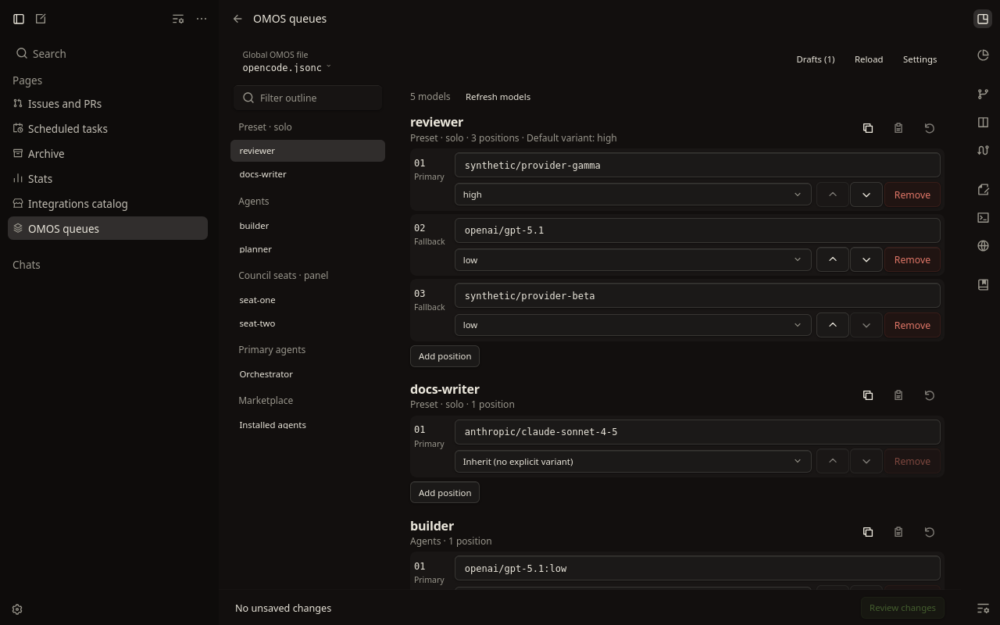

# OMOS queues

An unofficial [OpenChamber](https://github.com/openchamber/openchamber) extension for editing model fallback queues in a global [oh-my-opencode-slim](https://github.com/alvinunreal/oh-my-opencode-slim) configuration.

Licensed under the [MIT License](LICENSE).

- Pick a model from search, type a `provider/model` ID, or use a favorite. Set per-position variants and reorder positions manually.
- Copy, paste or reset one queue without changing the saved file. Recover a stored draft as a copy.
- Review the diff before saving. A confirmed save checks for concurrent changes and retains a backup next to the file.
- Stage a first Orchestrator default in a supported existing preset or edit [selections and overrides for installed marketplace agents](docs/MARKETPLACE-CONTRACT.md).



*Queue editor on desktop · Dark mode.* See the [desktop and phone screenshots](docs/SCREENSHOTS.md) or [watch two short feature demos](docs/SCREENSHOTS.md#feature-demos).

## Build and install

You need OpenChamber 2.7.1 or later with local extension services allowed, OpenCode, and an existing global OMOS JSONC or JSON file. Build with Node 22.22.1 and Bun 1.3.14. Run OpenChamber itself with a Node version it supports.

1. Clone this repository or download its source, then run this in the source directory:

   ```sh
   bun run build:zip
   ```

   This installs pinned dependencies, builds the extension, and packages the ZIP locally.
2. In OpenChamber, open **Settings → Extensions → Add extension**. Use **Browse ZIP archive** to upload `dist/omos-queues-<version>.zip`.
3. If you trust the code, choose **Allow and enable** for the local service. Then open **OMOS queues**.

[Watch the ZIP upload and first launch](docs/SCREENSHOTS.md#install-the-zip). This repository provides source only; you can't install `main` directly as a Git extension.

Open **OMOS queues → Settings** to confirm the global config path and OpenCode executable. If model enumeration needs a particular server working directory or OpenCode configuration directory, set those explicitly. A global preset default is not necessarily the effective model of a running session; project configuration can override it.

**Trust boundary:** the service runs with the connected OpenChamber server user's permissions. It is not a sandbox. Its settings choose which server files to read or edit and which executable to run with the `models` argument. Only enable it where everyone who can operate it is trusted with that access. Files, favorites and drafts are scoped to that server instance.

## Editing and saving

Search, Copy, Paste and Reset operate on the draft. **Review changes** opens the diff across the extension viewport. **Confirm and save** applies only the reviewed edits. Comments inside replaced values can be removed and are shown in the diff; unrelated file content stays intact. If a save outcome is unknown, check the file through the editor before trying again. A successful save does not reload OpenCode.

Favorites are local to the extension on the connected instance. You can optionally preview a read-only import from your OpenChamber profile; refreshing that preview does not replace stars. Marketplace configuration is likewise optional and does not install agents.

## Contributing

See [CONTRIBUTING.md](CONTRIBUTING.md) for running checks and writing a useful issue or pull request. The [technical contract](CONTRACT.md) describes the write boundaries. Browser emulation is not a physical-device test.

See [THIRD_PARTY_NOTICES.md](THIRD_PARTY_NOTICES.md) for bundled dependency notices.
