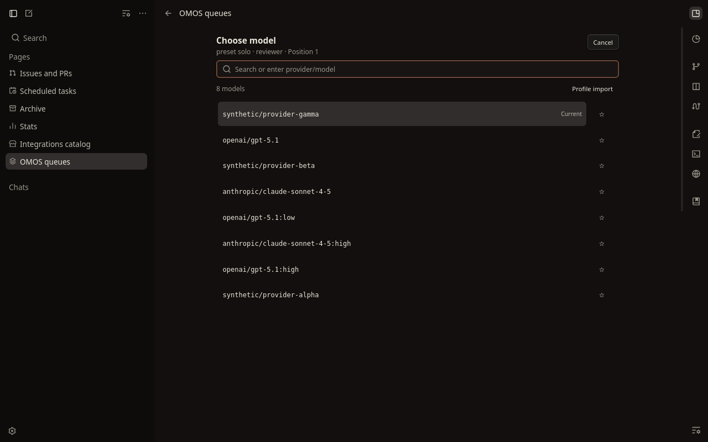
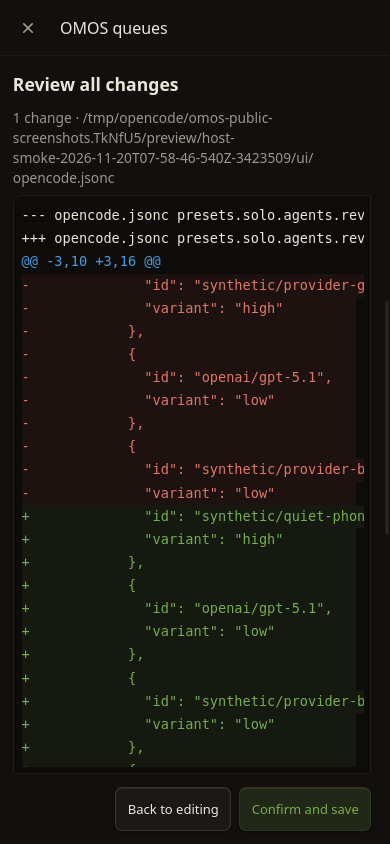
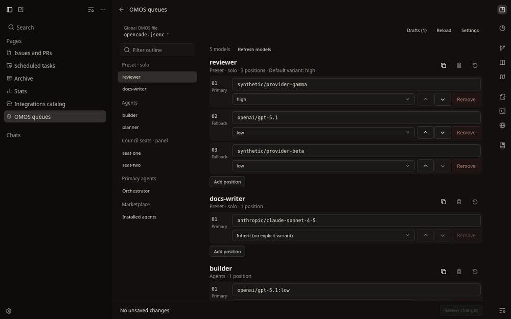
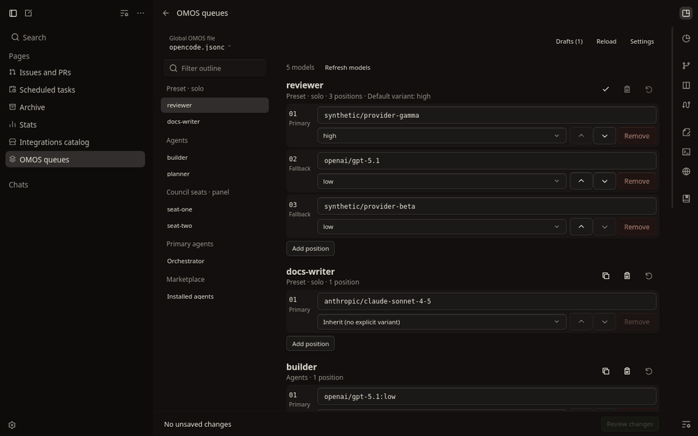

# OMOS queues screenshots

All screenshots and demos use dark mode and synthetic data in an isolated stock OpenChamber host. No real user settings or live configuration are shown.

The stills show OMOS queues 0.3.1 in OpenChamber 2.7.3, captured in Firefox at 1280 × 800 on desktop and 390 × 844 on an emulated phone. The phone capture is not a physical-device test.

## Queue editor on desktop

Fallback models are listed in order, with a variant selector and reorder controls for each position.

## Model picker on desktop

The picker lets you search for a model to use in the selected queue position.

## Review on an emulated phone

The review shows what will change, with **Back to editing** and **Confirm and save** fixed at the bottom of the phone viewport.

## Feature demos

Both demos stop before saving; the configuration file stays unchanged.

### Find a model

Open the picker, filter the list, and choose a model to stage it in the selected queue position.

Show the model picker GIF

### Copy a queue and review the diff

Copy one queue and confirm the paste into another. Open **Review changes** to see the diff, then choose **Back to editing** without saving.

Show the copy and review GIF

